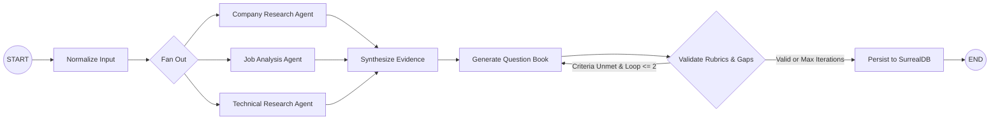
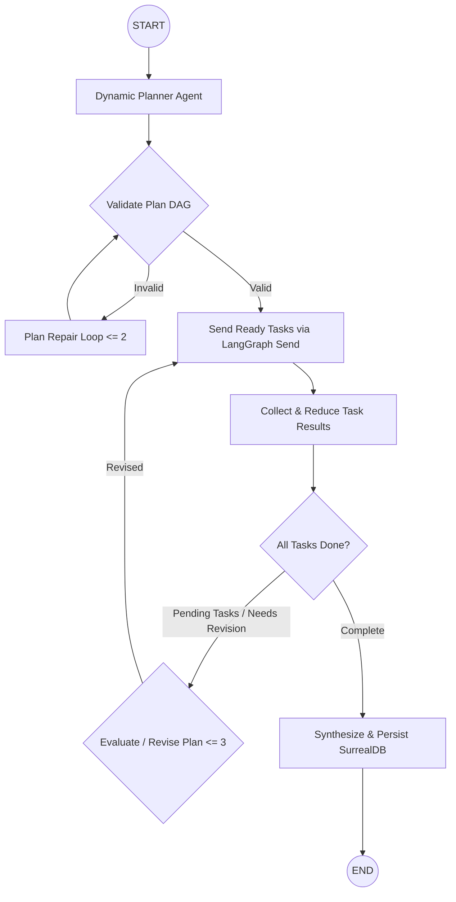
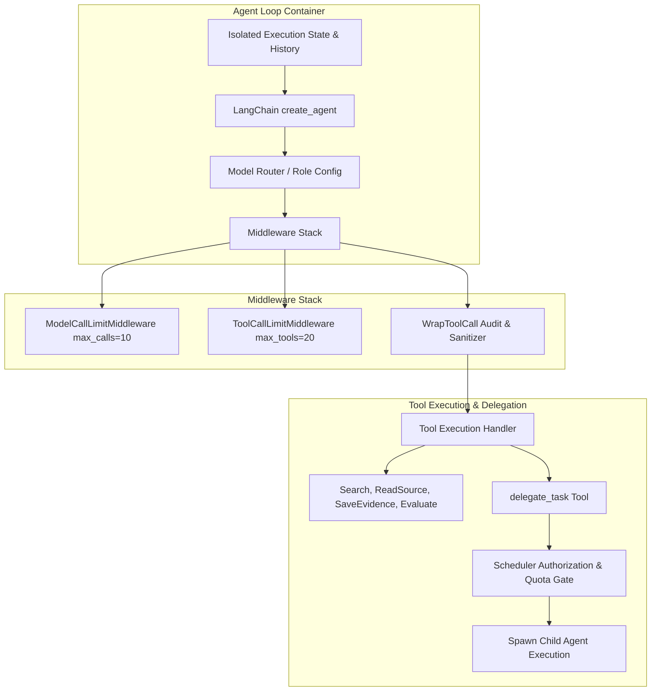

# Architecture Specification: Dual-Mode Multi-Agent Workflow Platform

## 1. System Audit & Migration Map

### 1.1 Verified Audit Findings
A comprehensive audit of the intelligence backend (`server/intelligence`) revealed critical architectural gaps and false claims in prior documentation (`docs/implementation/multi-agent-workflows.md`):

1. **Hardcoded Mock Agent Runtime (`src/agents/runtime.py`)**:
   - `run_agent_loop` implemented static `if/elif` branching on `agent_id`.
   - Emitted constant, fabricated findings (hardcoded requirements for `job-analysis`, canned questions for `interview-generation`, static patterns for `technical-research`).
   - No LLM orchestration, no autonomous dynamic tool selection, and no genuine reflection/recovery.
2. **Volatile In-Memory Event Store (`src/orchestration/event_store.py`)**:
   - Implemented as in-memory Python dictionary `_events: dict[str, list[ExecutionEvent]]`.
   - Sequence generation was `len(list) + 1` (vulnerable to concurrency races).
   - Event type naming used snake_case (`run_started`, `tool_called`) violating the public v1 dotted event schema (`workflow.started`, `tool.started`).
3. **Volatile Module State & Run ID Collision (`src/orchestration/workflow_service.py`)**:
   - Stored runs, tasks, artifacts, and cancel tokens in global module dictionaries (`WORKFLOW_RUNS`, `WORKFLOW_TASKS`, `WORKFLOW_ARTIFACTS`, `RUN_CANCEL_FLAGS`).
   - Run identifier hardcoded as `run_{workspace_id}`, causing immediate collision and state corruption on repeated interview prep runs for the same workspace.
4. **Mock Key Fallback on Production Paths (`src/llm/langchain_adapter.py`)**:
   - Fell back to `"mock-key"` when API keys were omitted, silently masking credential failures and producing synthetic mock models instead of failing fast and closed.
5. **Two Divergent Run-Creation Paths & BackgroundTasks Abuse**:
   - Path A: `POST /api/v1/workflows/runs` triggered un-enqueued `BackgroundTasks` directly within the web process.
   - Path B: `POST /internal/v1/pipelines/runs` and `/api/v1/workflows/trigger` enqueued into a basic Postgres queue for the legacy pipeline.
   - Workers suffered from catastrophic failure modes: catching all exceptions and setting `_saver = None` (fallback mode), using `thread_id = f"thread_{workspace_id}"` (causing cross-run checkpoint collisions), acquiring jobs before checking semaphores, lacking heartbeat leases, and dropping in-flight tasks on shutdown without draining.
6. **Legacy Artifact Divergence**:
   - SurrealDB tables (`job_description`, `resume`, `source`, `claim`, `company_research`, `match_analysis`, `skill`, `skill_relation`, `learning_unit`, `interview_question`) are required by the Rust API and Nuxt client. Any new workflow must preserve and guarantee these exact database mutations.

### 1.2 Old -> New Architecture Migration Map

| Legacy Component | New Multi-Agent Platform Component | Key Improvements & Invariants |
| :--- | :--- | :--- |
| `src/orchestration/workflow_service.py` (Dict storage & BackgroundTasks) | Single Unified Entrypoint `POST /internal/v1/workflows/runs` + Postgres Ledger | Atomic transaction: inserts run row (`uuid`), `workflow.created` event (`seq=1`), durable queue job. Fail closed (503 if DB/saver unavailable). |
| `src/orchestration/event_store.py` (In-memory dict, snake_case) | Postgres Monotonic Event Ledger (`execution_events` table) | Per-run monotonic `BIGINT` sequence via transaction lock. Dotted event taxonomy (`workflow.*`, `task.*`, `agent.*`, `tool.*`, `delegation.*`, etc.). |
| `src/agents/runtime.py` (Hardcoded if/elif) | LangChain v1 `create_agent` + Middleware & Tool Calling | Real LLM routing via LangChain v1, middleware for tool limits, model call limits, timeout policies, and structured schema outputs. |
| `src/llm/langchain_adapter.py` ("mock-key" fallback) | Strict Provider Configuration & Fail-Closed Validation | Hard failure on missing credentials in production; no silent fallbacks. Isolated mocks strictly for unit tests. |
| Divergent execution (`BackgroundTasks` vs Postgres Queue) | Durable Background Worker (`src/worker.py` / `DurableJobWorker`) | Capacity semaphore acquired *before* leasing; thread_id = `run_id`; fence tokens + heartbeat renewal; graceful drain on SIGINT/SIGTERM. |
| `src/orchestration/graphs/interview_graph.py` | Dual-Mode LangGraph Platform: Static StateGraph & Dynamic Dispatcher | Static graph: bounded fan-out/fan-in with validation loops. Dynamic graph: versioned planner emitting executable DAGs executed via LangGraph `Send`. |
| Unlinked database writes | Clear Persistence Separation (Postgres Ledger + SurrealDB Artifacts) | Postgres stores the execution ledger and LangGraph checkpoints; SurrealDB stores canonical product graphs, claims, and learning units. |

---

## 2. Platform Architecture Topology

```mermaid
graph TD
    subgraph Client and Gateway
        Nuxt[Nuxt 3 Frontend] -->|HTTP / SSE| RustAPI[Rust Core API]
        RustAPI -->|Verify Ownership & Proxy| IntelHTTP[FastAPI Intelligence HTTP]
    end

    subgraph Intelligence Ingestion & Ledger (Fail-Closed)
        IntelHTTP -->|Atomic Single-Path TX| PG_Ledger[(Postgres Execution Ledger)]
        PG_Ledger -->|Run, Task, Event seq=1, Job| PG_Ledger
    end

    subgraph Durable Worker Subsystem
        Worker[Durable Worker Process] -->|Acquire Semaphore -> Lease with Fence Token| PG_Ledger
        Worker -->|Heartbeat Loop every 5s| PG_Ledger
        Worker -->|Execute Thread| Engine[LangGraph Runtime Engine]
    end

    subgraph Dual-Mode Execution Engine
        Engine -->|Static Mode| StaticGraph[Static StateGraph: Fan-out / Fan-in]
        Engine -->|Dynamic Mode| DynamicGraph[Dynamic Dispatcher: Plan -> Send DAG -> Reduce]
        StaticGraph --> AgentRuntime[Agent Runtime: LangChain create_agent]
        DynamicGraph --> AgentRuntime
    end

    subgraph Agent Runtime & Middleware
        AgentRuntime --> Middleware[ToolCallLimit, ModelLimit, WrapTool Middleware]
        Middleware --> Tools[Safe Research Toolkit & delegate_task]
        Tools -->|Durable State & Outbox Events| PG_Ledger
        Tools -->|AsyncPostgresSaver Checkpoints| PG_Checkpoints[(Postgres Checkpointer)]
        Tools -->|Domain Entities & Graph Persist| Surreal[(SurrealDB Datastore)]
    end
```

---

## 3. Persistence Ownership & Datastore Split

To prevent split-brain consistency, telemetry contamination, and data ownership confusion, persistence responsibilities are strictly partitioned:

### 3.1 PostgreSQL: Execution Ledger & Checkpoints
PostgreSQL is the source of truth for all workflow execution state, agent observability, scheduling leases, and recovery checkpoints.
1. **Execution Ledger Tables** (Managed in the `mensetsu_orchestration` or `public` schema):
   - `workflow_runs`: `(id UUID PRIMARY KEY, workspace_id TEXT NOT NULL, user_id TEXT NOT NULL, workflow_id TEXT NOT NULL, workflow_type TEXT NOT NULL, status TEXT NOT NULL, progress_phase TEXT, progress_counts JSONB, plan_revision INT, created_at TIMESTAMPTZ, updated_at TIMESTAMPTZ, error_message TEXT)`.
   - `workflow_tasks`: `(id TEXT PRIMARY KEY, run_id UUID REFERENCES workflow_runs(id), task_type TEXT NOT NULL, name TEXT NOT NULL, assigned_agent TEXT NOT NULL, dependencies TEXT[], status TEXT NOT NULL, attempt INT DEFAULT 1, required BOOLEAN DEFAULT true, added_in_revision INT DEFAULT 1, input_data JSONB, output_data JSONB, error TEXT, created_at TIMESTAMPTZ, updated_at TIMESTAMPTZ)`.
   - `agent_executions`: `(id TEXT PRIMARY KEY, run_id UUID REFERENCES workflow_runs(id), task_id TEXT REFERENCES workflow_tasks(id), parent_execution_id TEXT, agent_id TEXT NOT NULL, objective TEXT NOT NULL, status TEXT NOT NULL, model_provider TEXT, model_name TEXT, tokens_used INT, tool_call_count INT, public_summary TEXT, error TEXT, started_at TIMESTAMPTZ, completed_at TIMESTAMPTZ)`.
   - `tool_invocations`: `(id TEXT PRIMARY KEY, execution_id TEXT REFERENCES agent_executions(id), tool_name TEXT NOT NULL, sanitized_input JSONB, output_summary TEXT, output_ref TEXT, duration_ms FLOAT, status TEXT, started_at TIMESTAMPTZ, completed_at TIMESTAMPTZ)`.
   - `delegations`: `(id TEXT PRIMARY KEY, run_id UUID REFERENCES workflow_runs(id), parent_execution_id TEXT NOT NULL, child_execution_id TEXT NOT NULL, delegation_task_id TEXT NOT NULL, reason TEXT NOT NULL, status TEXT NOT NULL, created_at TIMESTAMPTZ, completed_at TIMESTAMPTZ)`.
   - `execution_events`: Monotonic ordered event outbox table. `(run_id UUID NOT NULL, seq BIGINT NOT NULL, event_id TEXT NOT NULL, ts TIMESTAMPTZ NOT NULL, type TEXT NOT NULL, task_id TEXT, execution_id TEXT, parent_execution_id TEXT, tool_invocation_id TEXT, correlation_id TEXT, trace_id TEXT, payload JSONB NOT NULL, PRIMARY KEY(run_id, seq))`.
   - `execution_logs`: `(id BIGSERIAL PRIMARY KEY, run_id UUID NOT NULL, seq BIGINT, task_id TEXT, execution_id TEXT, severity TEXT NOT NULL, message TEXT NOT NULL, attributes JSONB, ts TIMESTAMPTZ NOT NULL)`.
   - `durable_job_queue`: `(id UUID PRIMARY KEY, run_id UUID REFERENCES workflow_runs(id), status TEXT NOT NULL, priority INT DEFAULT 0, locked_by TEXT, locked_at TIMESTAMPTZ, lease_token UUID, lease_expires_at TIMESTAMPTZ, retry_count INT DEFAULT 0, max_retries INT DEFAULT 3, created_at TIMESTAMPTZ, updated_at TIMESTAMPTZ)`.
2. **LangGraph Checkpoint Storage**:
   - Handled via `langgraph-checkpoint-postgres` (`AsyncPostgresSaver`).
   - Tables (`checkpoints`, `checkpoint_blobs`, `checkpoint_writes`, `checkpoint_migrations`) reside in a dedicated schema or standard tables keyed by `thread_id = run_id`. Checkpointer state is isolated from the application ledger tables to permit independent migration and indexing.

### 3.2 SurrealDB: Product Application Domain Entities
SurrealDB stores high-level business entities consumed by the Rust API and Nuxt web application. Records in SurrealDB are strictly user- and workspace-partitioned:
- `workspace`, `job_description`, `resume`: Root job intelligence inputs.
- `source`, `source_chunk`, `claim`: Evidence hierarchy supporting citation provenance.
- `company_research`, `match_analysis`: Synthesis reports and match gaps.
- `skill`, `skill_relation`: Knowledge graph nodes and prerequisite dependency edges.
- `learning_unit`, `interview_question`: Curated interactive study material.
- **Linkage**: Rows in Postgres `artifacts` contain `surreal_record_id` pointing to the exact SurrealDB record (e.g. `source:src_123`, `interview_question:q_456`).

---

## 4. Dual-Mode Workflow Design

### 4.1 Static Workflow (`interview-preparation-static`)
A deterministic, fan-out/fan-in Directed Acyclic Graph providing predictable SLAs for candidate onboarding:



1. **Phase 1: Input Normalization**: Parses resume document/text and job description markdown/URL; verifies SSRF compliance on provided URLs.
2. **Phase 2: Parallel Research Fan-Out**: Dispatches 3 parallel sub-branches via LangGraph branch edges:
   - `company-research`: Scraping official site, parsing company culture, mission, tech stack.
   - `job-analysis`: Extracting hard requirements, soft skills, seniority indicators, and required tools.
   - `technical-research`: Sourcing engineering blogs, architectural patterns, and tech-specific interview themes.
3. **Phase 3: Synthesis**: Merges multi-source evidence, computes match ratio, identifies candidate gaps, and drafts curriculum modules.
4. **Phase 4: Question Generation**: Generates contextual interview questions with answer rubrics, pitfalls, and follow-ups.
5. **Phase 5: Bounded Conditional Validation Loop**: Evaluates generated rubrics against identified gaps. If critical skills lack coverage, re-invokes generation with a strict loop bound of $\le 2$ iterations.
6. **Phase 6: Atomic Persistence**: Commits final entities to SurrealDB using `persist_record` and emits `artifact.created` events to the Postgres ledger.

### 4.2 Dynamic Workflow (`interview-preparation-dynamic`)
An adaptive, autonomous planner-driven DAG engine that handles open-ended, specialized, or deep technical interview preparation requirements.



1. **Dynamic Task Validation Rules**:
   - **Known Agents**: Every task must map to a registered agent ID in `AgentRegistry`.
   - **ID Uniqueness & Dep Integrity**: All task IDs must be unique; dependencies must reference preceding task IDs in the same plan.
   - **Acyclicity**: Graph must be an acyclic directed graph (verified via topological sort / Kahn's algorithm).
   - **Bounds & Depth**: Maximum of 15 tasks per plan; maximum task dependency depth $\le 4$; maximum plan revisions $\le 3$.
   - **Tool Policies & Budget Quota**: Tasks must operate within the assigned agent's allowed tools and token/time limits.
2. **Concurrent Dispatch via LangGraph `Send`**:
   - Ready tasks (tasks whose dependencies have `completed` status) are dynamically scheduled using LangGraph `Send("execute_task", task)`.
   - Results are collected in a custom state reducer `Annotated[list[TaskResult], merge_task_results]`.

---

## 5. Agent Runtime & Delegation Engine

### 5.1 Unified Runtime Architecture
Both static and dynamic modes utilize a single `AutonomousAgentRuntime` powered by LangChain v1 `create_agent`.



1. **Per-Execution Isolation**:
   - Every task or sub-agent execution receives a freshly initialized message history with explicit task context, boundaries, and system prompts.
   - No cross-contamination of conversation threads between concurrent agents.
2. **Execution Budgets & Guardrails**:
   - `max_model_calls`: 10 per execution.
   - `max_tool_calls`: 20 per execution.
   - `max_wall_time_ms`: 120,000 ms (2 minutes).
   - `max_delegation_depth`: 3 levels.
   - `max_children_per_agent`: 3 sub-agents.
3. **Delegation Protocol (`delegate_task`)**:
   - Agents cannot spawn unbounded threads directly. All delegation invocations invoke the `delegate_task` tool.
   - Validates caller permissions against `agent.delegation_permissions`.
   - Checks that current depth $< 3$ and cycle detection verifies that the target agent is not in the caller's ancestry path.
   - Creates a durable `Delegation` record and records `delegation.requested`, `delegation.accepted`, `delegation.started`, and `delegation.completed` events.

---

## 6. Scheduling, Leasing & Recovery

### 6.1 Lease-Based Scheduling & Fencing
To support multi-node scaling and prevent split-brain execution across worker crashes:
1. **Pre-Lease Capacity Gate**:
   - Workers instantiate an `asyncio.Semaphore(max_concurrency)`.
   - The worker MUST acquire a semaphore slot **before** polling or leasing a job from the database.
2. **Atomic Lease Acquisition**:
   - Jobs are claimed via `UPDATE durable_job_queue SET status = 'running', locked_by = :worker_id, lease_token = :token, lease_expires_at = NOW() + INTERVAL '30 seconds' WHERE id = (SELECT id FROM durable_job_queue WHERE status = 'pending' ORDER BY priority DESC, created_at ASC LIMIT 1 FOR UPDATE SKIP LOCKED) RETURNING *`.
3. **Heartbeat Loop**:
   - A background heartbeat task runs every 5 seconds for each active job, renewing `lease_expires_at = NOW() + INTERVAL '30 seconds'` matching `lease_token`.
   - On every ledger update or state write, the worker validates fence token ownership. If the lease expired or was reclaimed by another worker, execution halts immediately.

### 6.2 Crash Recovery
1. **Thread Resume**:
   - When a worker restarts or picks up an abandoned job (`status = 'running'` with expired lease), it initializes the LangGraph graph with `checkpointer = AsyncPostgresSaver(pool)`.
   - Invokes `graph.ainvoke(None, config={"configurable": {"thread_id": str(run_id)}})`.
2. **Task Idempotency**:
   - Task executions check the Postgres `workflow_tasks` table for existing completed outputs keyed by `(run_id, task_id, attempt)`.
   - Already completed tasks yield cached outputs immediately without re-executing LLM or external network requests.
3. **Graceful Shutdown**:
   - On `SIGTERM` or `SIGINT`, the worker immediately stops polling for new jobs.
   - Allows a configurable drain timeout (default 30 seconds) for in-flight tasks to checkpoint progress.
   - If drain timeout expires, tasks cancel cooperatively and release leases back to `pending`.

---

## 7. Progress Model, Observability & Redaction

### 7.1 Deterministic Progress Model
- **State Counts**: UI tracks exact task tallies: `{ total: N, pending: P, queued: Q, running: R, completed: C, failed: F, retrying: T, skipped: S }`.
- **Phase & Plan Revision**: Reports current phase (e.g. `discovery`, `research`, `synthesis`, `finalization`) and `plan_revision`.
- **Percentage Calculation**:
  - For **static** workflows (where total task count is fixed), percentage is calculated deterministically as $\text{round}((C / N) \times 100)$.
  - For **dynamic** workflows (where tasks can be expanded or revised), percentage includes an explicit boolean flag: `{ "percent": 45, "estimate": true }`.

### 7.2 Correlation, Logging & Redaction
- **Unified Correlation**: Every run binds a W3C `trace_id` and `correlation_id` passed through Rust API down to tool executions and SurrealDB statements.
- **Log Sanitation Invariant**:
  - PII (candidate email, phone, raw resume address) and credentials (API keys, authorization headers) are masked via regex redactors before entering `execution_logs` or `tool_invocations`.
  - Public summaries are published to `agent_executions`; raw chain-of-thought scratchpads are never leaked to user-facing APIs.
