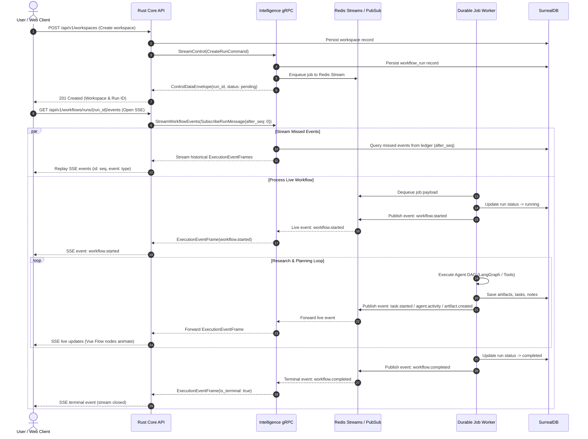

# System Architecture & Service Interconnection

This document specifies the end-to-end architecture of **Mensetsu** (面接), including service topologies, protocol boundaries, persistence tiers, and bi-directional communication channels.

---

## 1. High-Level System Topology

```mermaid
flowchart TD
    User([Candidate / Browser])

    subgraph Edge ["Frontend Layer"]
        Web["Nuxt 3 Web Client<br/><code>app/web</code> (Port :3001)<br/>Vue Flow, Tailwind, Nitro SSR"]
    end

    subgraph Backend ["Core API Tier"]
        API["Rust Axum API<br/><code>server/api</code> (Port :3000)<br/>Identity, Auth, Workspaces, OpenAPI"]
    end

    subgraph IntelligenceTier ["Intelligence & AI Research Tier"]
        gRPCServer["Python gRPC Server<br/><code>server/intelligence</code> (Port :50051)<br/>DataControl & Streaming Services"]
        Worker["Durable Agent Worker<br/><code>server/intelligence</code> (Scalable)<br/>LangGraph, Pydantic AI, Tool Loop"]
    end

    subgraph StateStorage ["Persistence & Coordination"]
        SurrealDB[("SurrealDB 3.x<br/>Relational, Graph, Document")]
        Redis[("Redis Stack<br/>Pub/Sub, Stream Queue, Checkpointing")]
        SearXNG["SearXNG (Port :8080)<br/>SSRF-guarded Web Search"]
    end

    User <-->|HTTP REST & SSE| Web
    Web <-->|Proxied REST & SSE| API
    
    API <-->|gRPC StreamControl (Bidi HTTP/2)| gRPCServer
    API <-->|gRPC StreamWorkflowEvents (Bidi HTTP/2)| gRPCServer
    
    API <-->|WebSocket SDK / SQL| SurrealDB
    
    gRPCServer <-->|SurrealDirectClient / HTTP| SurrealDB
    gRPCServer <-->|Redis Streams & Pub/Sub| Redis
    
    Worker <-->|SurrealDirectClient / HTTP| SurrealDB
    Worker <-->|Redis Streams & Pub/Sub| Redis
    Worker <-->|Search Queries| SearXNG
    Worker <-->|LLM Inference (OpenAI / BYOK)| ExternalLLM[("LLM Providers<br/>OpenAI, Anthropic, Ollama")]
```

---

## 2. Service Communication Protocols

### 2.1 Public Client $\longleftrightarrow$ Rust Core API
- **Protocol**: HTTP/1.1 & HTTP/2 REST + Server-Sent Events (SSE).
- **Contracts**: Defined in `contracts/rest/openapi.json` and generated into `@mensetsu/contracts` (`contracts/rest/src/generated/api.ts`).
- **Authentication**: JWT Bearer Tokens in `Authorization` header and encrypted session cookies.
- **SSE Stream**: `GET /api/v1/workflows/runs/{run_id}/events` streams execution telemetry (`task.started`, `agent.activity`, `workflow.completed`, etc.) directly into frontend stores and Vue Flow diagrams.

### 2.2 Rust Core API $\longleftrightarrow$ Python Intelligence Tier
- **Protocol**: Pure HTTP/2 Full-Duplex Bi-directional gRPC.
- **Port**: `50051`.
- **Contracts**: Defined in `contracts/grpc/proto/v1/`:
  1. `control.proto` (`DataControlService`):
     - Multiplexed channel for triggering runs, querying state, cancelling executions, and retrieving paginated telemetry chunks using correlation IDs.
  2. `streaming.proto` (`WorkflowEventStreamService`):
     - Full-duplex channel where the Rust API sends dynamic subscription messages (`subscribe`, `unsubscribe`, `ack`, `ping`) and receives real-time `ExecutionEventFrame` payloads.
  3. `health.proto` (`grpc.health.v1.Health`):
     - Standard container and service health status.
- **Authentication**: Fail-closed internal bearer token (`INTERNAL_SERVICE_TOKEN`) checked by `GrpcAuthInterceptor` on invocation metadata.

### 2.3 Intelligence Service $\longleftrightarrow$ Worker Coordination
- **Redis Streams**: Acts as the job queue. When `CreateRun` is commanded, the intelligence server enqueues job payloads onto Redis Streams (`mensetsu:jobs`).
- **Redis Pub/Sub**: Real-time event pub/sub. As agents execute tasks in workers, events are published to Redis channels (`events:<run_id>`), allowing all scaled intelligence gRPC replicas to stream live frames to the API.
- **SurrealDB**: Ground truth for all workflow entities:
  - Tables: `workflow_run`, `workflow_task`, `agent_execution`, `tool_invocation`, `delegation`, `artifact`, `execution_event`.

---

## 3. Workflow Execution Lifecycle



---

## 4. Contract Layout

```
contracts/
├── rest/                     # Client boundary: REST endpoints, schemas, TypeScript types
│   ├── openapi.json          # Exported from Rust utoipa
│   ├── schema/               # Deep domain event JSON schema (workflows.v1.json)
│   ├── fixtures/             # Golden test fixtures
│   ├── src/                  # @mensetsu/contracts TypeScript package
│   └── scripts/              # OpenAPI -> TS and Schema -> TS code generators
│
└── grpc/                     # Internal boundary: Inter-service RPCs
    ├── proto/v1/             # control.proto, streaming.proto, health.proto
    └── scripts/              # gen-proto.sh (Compiles proto stubs to Python)
```
