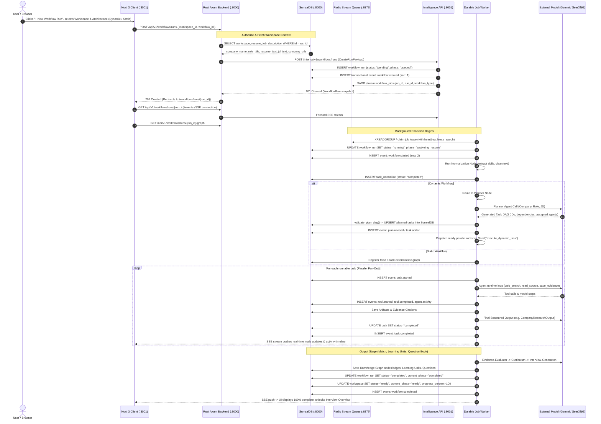

# Mensetsu Workflow Execution Flow

This document details the end-to-end lifecycle and execution architecture when a user submits a new workflow run (Static or Dynamic) in Mensetsu.

---

## 1. End-to-End Sequence Diagram



---

## 2. Component Responsibilities & Lifecycle Stages

### Stage 1: Ingestion & Validation
- **Caller**: Web browser client (`app/web`).
- **Endpoint**: `POST /api/v1/workflows/runs`.
- **Payload**:
  ```json
  {
    "workspace_id": "f28ae63c-41dd-4a12-9081-1941b4611433",
    "workflow_id": "interview-preparation-dynamic" // or "interview-preparation-static"
  }
  ```
- **Backend Action (`server/api`)**:
  1. Authorizes caller token via JWT claims.
  2. Verifies workspace ownership in SurrealDB (`workspace:<id>`).
  3. Queries stored inputs: resume text/base64 PDF, job description text/URL, company URLs, and user LLM settings.
  4. Dispatches an internal authenticated POST request to `http://mensetsu-intelligence:8001/internal/v1/workflows/runs`.

---

### Stage 2: Run Creation & Durable Queue Enqueue
- **Service**: Intelligence API (`server/intelligence/src/service.py`).
- **Database Operations**:
  - Creates a new `WorkflowRun` record in SurrealDB (`workflow_run:<run_id>`) with initial status `pending` and current phase `queued`.
  - Appends sequence event `1` (`workflow.created`) to the transactional event ledger.
- **Queueing (`Redis`)**:
  - Enqueues a persistent job payload into the Redis Stream (`stream:workflow_jobs`).
  - Returns `201 Created` with the run snapshot to the API, which relays it to the browser.
  - The browser redirects to `/workflows/runs/{run_id}` and connects an EventSource to `/api/v1/workflows/runs/{run_id}/events`.

---

### Stage 3: Job Worker Lease Claim & Startup
- **Service**: Durable Job Worker (`server/intelligence/src/worker.py`).
- **Execution**:
  1. Worker claims the job from the Redis Consumer Group using an expiring lease token (`lease_epoch`).
  2. Spawns a background heartbeat task to renew the lease in Redis every 5 seconds.
  3. Transitions run status to `running`, phase to `analyzing_resume`, and emits event `2` (`workflow.started`).

---

### Stage 4: Orchestration & DAG Compilation
The worker initializes the LangGraph state machine based on `workflow_id`:

#### A. Static Workflow (`interview-preparation-static`)
- Pre-wires a fixed 9-task deterministic graph:
  - `task_normalize` $\rightarrow$ Parallel Fan-out: [`task_company`, `task_tech`, `task_job`] $\rightarrow$ `task_synth` $\rightarrow$ `task_curriculum` $\rightarrow$ `task_qgen`.

#### B. Dynamic Workflow (`interview-preparation-dynamic`)
1. **Normalization Node (`normalize`)**: Cleans CV text/PDF, normalizes JD requirements, and saves parsed skills.
2. **Planner Node (`plan`)**:
   - Dispatches the `planner` agent with target role, company, JD, and available research agents.
   - The planner outputs an adaptive task DAG.
   - The worker validates the plan against hard boundaries:
     - Maximum 15 tasks (`MAX_PLAN_TASKS = 15`).
     - Maximum 4 research tasks per revision.
     - Maximum DAG depth of 4 (`MAX_PLAN_DEPTH = 4`).
     - Strictly acyclic.
     - `job-analysis` is mandatory and required.
     - Total planned tool budget $\le 240$.
   - Valid tasks are inserted into SurrealDB, emitting `plan.revised` and `task.added` events.
3. **Execution & Join Nodes (`execute_dynamic_task`, `join`)**:
   - Ready tasks with zero unmet dependencies are dispatched concurrently via LangGraph `Send()`.
4. **Revision Node (`revise`)**:
   - Once initial root research tasks complete, the planner reviews early findings and can introduce targeted follow-up tasks (plan revision 2).

---

### Stage 5: Autonomous Sub-Agent Tool Loop
For each dispatched task:
1. Emits `task.started` and assigns an isolated execution record (`exec_<id>`).
2. Autonomous agent loop runs within configured budgets (wall time, tool calls, model calls).
3. Agents utilize tools:
   - `web_search`: Queries the local SearXNG engine with SSRF filters.
   - `read_source`: Fetches page content and sanitizes HTML.
   - `save_evidence`: Saves authoritative verbatim citations (`art_<id>`).
   - `save_finding`: Stores structured observations linked to saved evidence IDs.
4. **Budget Finalizer & Headroom**:
   - When remaining time drops below 90s or remaining tool calls $\le 2$, research tools are disabled.
   - The agent is forced to call the structured output tool (e.g. `CompanyResearchOutput`).
   - Built-in headroom allows for schema validation repairs without timing out.
5. On task completion, artifacts and public summaries are persisted in SurrealDB, emitting `task.completed`. Updates stream to the web client via SSE.

---

### Stage 6: Output Synthesis & Finalization
Once all upstream research completes:
1. **Evidence Evaluator**: Performs multi-dimensional CV/JD match analysis and identifies concrete gaps.
2. **Curriculum Agent**: Generates structured, prerequisite-ordered learning modules and constructs the SurrealDB knowledge graph.
3. **Interview Generation Agent**: Writes a company- and role-grounded interview question book with rubrics, expected answers, and follow-ups.
4. **Final State Transition**:
   - Run status set to `completed`, progress to `100%`.
   - Target workspace marked `status = "ready"`, `current_phase = "ready"`, unlocking full interview prep in the web UI.
   - Transactional event `workflow.completed` emitted.
